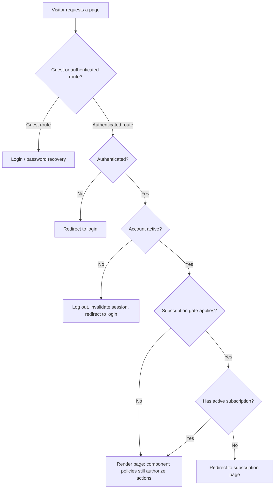
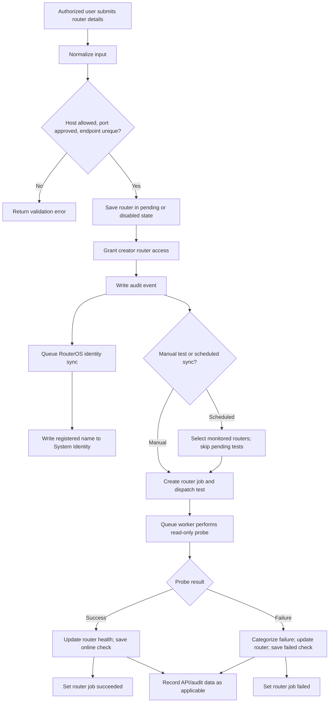
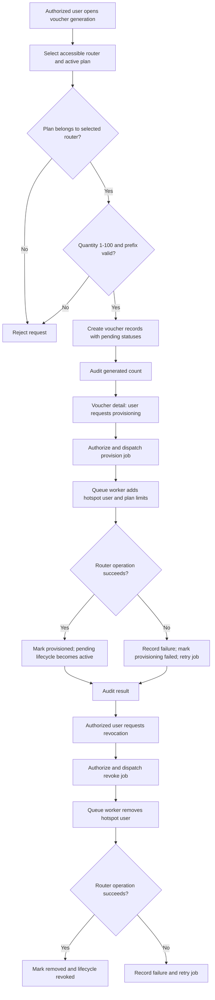
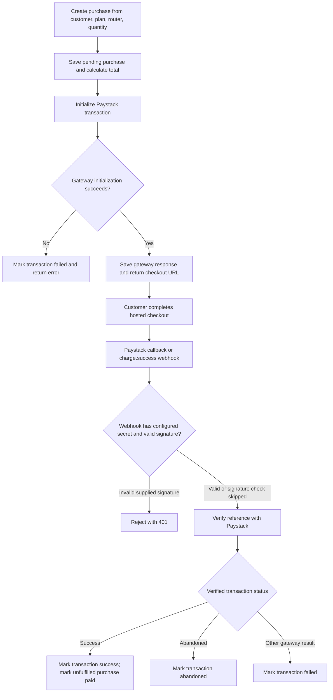
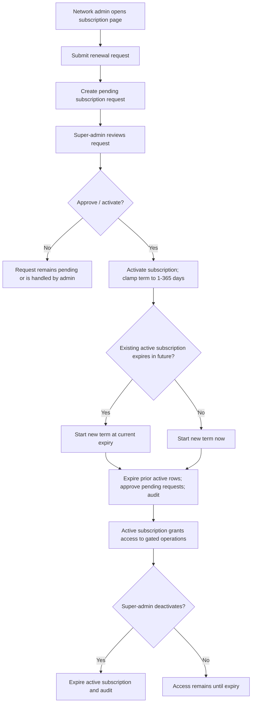

# Process Flows and Test Cases

This document describes the core flows currently implemented in MMUTech and a focused regression-test set for them. The diagrams reflect the code paths in this repository; they do not imply that missing integrations are already available.

## 1. Authentication and access

Operational pages use authentication, active-account, and subscription middleware. The subscription page and account-password page remain available to authenticated, active users. Component mount/action policies provide a second authorization check.

## 2. Router registration and health checks

A successful probe resets consecutive failures and stores observed router details. A failed probe marks an enabled router offline or error depending on its category; disabled and archived routers retain their status. Router name changes also queue an identity sync. Scheduled checks process monitored routers in batches and avoid creating a second pending connection test.

Bridge configuration is a separate, administrator-triggered flow: discover the current Ethernet interfaces, select the intended LAN ports, explicitly confirm the management-connectivity warning, and queue a job. The worker re-reads current interfaces and bridge membership, creates the named bridge only if needed, rejects ports assigned to another bridge, and adds only the selected ports. It does not configure addressing or DHCP.

LAN network configuration is another tracked flow. Administrators select a discovered, unbridged WAN interface and provide the LAN address/prefix, DHCP pool, upstream DNS servers, and management source CIDRs; the UI has no implicit network defaults. After explicit impact confirmation, the worker preflights resource conflicts, applies managed DHCP/NAT/firewall resources idempotently, and saves a RouterOS read-back report. A separate verify job only reads saved configuration state. Reports distinguish mismatches from warnings, including existing rule precedence, shadowed WAN ACCEPT rules, and missing WAN addressing/default routes.

## 3. Voucher generation, provisioning, and revocation

Voucher lifecycle and provisioning status are separate. Voucher generation does not itself provision credentials, and the payment verification flow does not automatically generate or provision vouchers.

## 4. Purchase and Paystack payment

The payment path is implemented as services and callback/webhook endpoints. No customer-facing checkout action or automatic voucher fulfillment was found in the current UI. The webhook skips signature validation if either the configured secret or signature header is missing; production configuration should require and validate both. Callback verification errors are logged but not rethrown; if a matching purchase exists, the callback still displays “Payment verified.” This is a success-looking response even when verification failed.

## 5. Subscription renewal and administration

Renewal requests are not payment-backed. A super-admin activates or deactivates subscriptions manually. Activation extends from a still-future expiry and ensures only the new record remains active.

## Regression test cases

Use isolated database fixtures and fake queues/HTTP/router gateways where applicable. “Existing coverage” identifies a directly related test already present; it does not mean every assertion below is currently automated.

### Authentication and access

| ID | Scenario and steps | Expected result | Coverage |
|---|---|---|---|
| AUTH-01 | As a guest, request an operational page such as `/dashboard`. | Redirect to `/login`; no protected page data is rendered. | Existing: `AuthenticationTest` |
| AUTH-02 | Authenticate as a suspended user and request an operational page. | Session is logged out/invalidated and request redirects to login. | Existing: `AuthenticationTest` |
| AUTH-03 | As a network admin with no active subscription, request `/dashboard`, then `/subscription`. | Dashboard redirects to subscription page; subscription page remains accessible. | Existing: `SubscriptionGatingTest` |
| AUTH-04 | As a network admin with an active subscription, request `/dashboard`. | Request succeeds. | Existing: `SubscriptionGatingTest` |
| AUTH-05 | As a super-admin and as support without a subscription, request `/dashboard`. | Request succeeds for both roles. | Existing: `SubscriptionGatingTest` |
| AUTH-06 | As an authenticated user, log out and then request `/dashboard`. | Logout redirects to login; subsequent request is treated as a guest. | Existing: `AuthenticationTest` |
| AUTH-07 | Submit invalid credentials and request a password reset for a registered account. | Invalid credentials do not authenticate; reset response avoids account enumeration and queues/sends the reset notification according to configured behavior. | Recommended; not covered by the inspected auth test |

### Router registration and health

| ID | Scenario and steps | Expected result | Coverage |
|---|---|---|---|
| RTR-01 | Create a router with a disallowed host, duplicate host/port, or HTTP port while HTTP is disabled. | Validation fails; no router or access-pivot row is created. | Recommended |
| RTR-02 | Create a router with an allowed endpoint as an authorized user. | Router is pending (or disabled when monitoring is off), creator receives access, and an audit event is recorded. | Partial: `RouterAccessTest` checks creator access |
| RTR-03 | As a user without access, view a router; then grant access and retry. | First request is forbidden; second succeeds; router index excludes unassigned routers. | Existing: `RouterAccessTest` |
| RTR-04 | Run a connection test with a successful fake probe. | Health check and router health fields are updated; failure count resets; associated router job succeeds. | Partial: `RouterJobTest` covers router-job status, not the probe result |
| RTR-05 | Run a connection test with authentication/configuration failure and with a connectivity failure. | Health check records the category; enabled router becomes error for authentication/configuration or offline for connectivity; failure count increments; sensitive error content is redacted. | Recommended |
| RTR-06 | Trigger scheduled sync with monitored, disabled, and already-pending routers. | Only monitored routers without an existing pending test are queued; no duplicate check is created. | Partial: `RouterJobTest` covers pending-test detection |

### Vouchers

| ID | Scenario and steps | Expected result | Coverage |
|---|---|---|---|
| VCH-01 | Generate vouchers using an accessible router, active plan belonging to it, valid quantity, and optional alphanumeric prefix. | Requested count is created with unique usernames, pending lifecycle/provisioning states, and a generation audit event. | Recommended |
| VCH-02 | Attempt generation with an inaccessible router, inactive/cross-router plan, quantity outside 1-100, or invalid prefix. | Request is denied or validation fails; no vouchers are created. | Partial: `VoucherPolicyTest` checks generate permission |
| VCH-03 | Attempt to provision or revoke without the corresponding permission. | Action is forbidden; no queue job is dispatched and voucher state is unchanged. | Partial: `VoucherPolicyTest` checks revoke permission |
| VCH-04 | Provision a pending voucher with a successful fake router connection. | Router receives the correct username, password, plan profile, and configured data/time limits; provisioning becomes provisioned and pending lifecycle becomes active. | Recommended |
| VCH-05 | Provision when the router operation fails. | Failure is recorded, provisioning becomes failed, exception is rethrown for queue retry, and final job failure leaves voucher visibly failed. | Recommended |
| VCH-06 | Revoke a successfully provisioned voucher with a successful router response. | Router user is removed; provisioning becomes removed; lifecycle becomes revoked; revocation time and audit event are saved. | Recommended |
| VCH-07 | Revoke when the router is unavailable through all retries. | The voucher must not be reported as successfully removed; failure is observable and retry/final-failure state is consistent. | Recommended; final revocation failure currently has no job `failed()` state update |

### Payments

| ID | Scenario and steps | Expected result | Coverage |
|---|---|---|---|
| PAY-01 | Create a purchase and initialize checkout with a successful Paystack HTTP response. | Purchase remains pending; pending transaction contains the expected amount in minor units, reference, and checkout response. | Recommended; no payment test file found |
| PAY-02 | Initialize checkout with a failed/non-success Paystack response. | Transaction is marked failed with gateway response/reason; initialization returns an error. | Recommended |
| PAY-03 | Verify a known reference with gateway status `success`. | Transaction becomes successful with verification/payment timestamps; associated unfulfilled purchase becomes paid. | Recommended |
| PAY-04 | Verify references with `abandoned`, failed, and unknown local transaction outcomes. | Transaction state reflects the gateway result; unknown local reference does not create or alter a transaction. | Recommended |
| PAY-05 | Send a webhook with a configured secret and invalid signature, then with a valid signature and `charge.success`. | Invalid signature receives 401 and performs no verification; valid event triggers server-side verification. | Recommended |
| PAY-06 | Send the same successful webhook more than once. | Repeated delivery does not create duplicate financial effects or unintended state transitions. | Recommended; webhook event idempotency is not evident in the inspected handler |
| PAY-07 | Return a verification error during the browser callback for a reference linked to a purchase. | Error is logged; callback must not report or display the payment as verified. | Recommended; currently logs the error but can display “Payment verified.” |

### Subscriptions

| ID | Scenario and steps | Expected result | Coverage |
|---|---|---|---|
| SUB-01 | As a network admin without an active subscription, submit a renewal request. | A pending subscription request is created and operational routes remain gated. | Existing: `SubscriptionGatingTest` |
| SUB-02 | As a non-super-admin, attempt activation and deactivation. | Both operations throw an authorization error and do not change subscription rows. | Existing: `SubscriptionServiceTest` |
| SUB-03 | As a super-admin, activate a user with no active subscription. | New subscription is active, has the requested plan/term, and an audit event is written. | Existing: `SubscriptionServiceTest` |
| SUB-04 | Activate while an existing active subscription expires in the future and a renewal request is pending. | New term starts at the old expiry; old active row expires; pending request becomes approved; only one row is active. | Existing: `SubscriptionServiceTest` |
| SUB-05 | Activate with day values below 1 or above 365. | Term is clamped to 1 or 365 days respectively. | Recommended |
| SUB-06 | As a super-admin, deactivate a user with an active subscription. | Active rows expire, access is gated again, and deactivation is audited; no-active-subscription case returns zero without a false state change. | Existing: `SubscriptionServiceTest` covers the active case |

## Current coverage snapshot

The repository already has focused tests for authentication access, router visibility, plan/router scoping, voucher permissions, router-job state, and subscription gating/service behavior. Payment initialization/verification/webhooks and actual voucher router operations need dedicated regression tests. Run the existing suite with `php artisan test`; run a focused test file with `php artisan test --compact <path-to-test>`.
